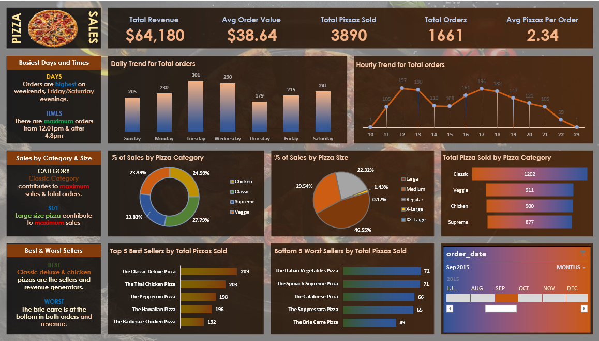

# 🍕 Pizza Sales Analysis Dashboard

## 📌 Project Overview
An interactive Pizza Sales Dashboard designed to analyze sales performance, customer ordering patterns, and product popularity using key performance indicators (KPIs) and visualizations.

## 🎯 KPIs
- Total Revenue
- Average Order Value
- Total Pizzas Sold
- Total Orders
- Average Pizzas Per Order

## 📊 Dashboard Insights
- Daily and hourly order trends
- Sales percentage by pizza category and size
- Total pizzas sold by category
- Top 5 best-selling pizzas
- Bottom 5 worst-selling pizzas
- Date-based sales filtering

## 🛠️ Tools Used
- **SQL (PostgreSQL):** Data querying and analysis
- **Power BI:** Dashboard development and visualization

## 💡 Business Objective
To identify sales trends, understand customer preferences, evaluate product performance, and support data-driven business decisions.

## 📈 Key Findings
- Total Revenue: $64,180
- Total Pizzas Sold: 3,890
- Total Orders: 1,661
- Average Order Value: $38.64
- Average Pizzas Per Order: 2.34

## 👩‍💻 Author
**Pranali Valve**
Created as a data analytics project to demonstrate SQL, data analysis, and dashboard visualization skills.
